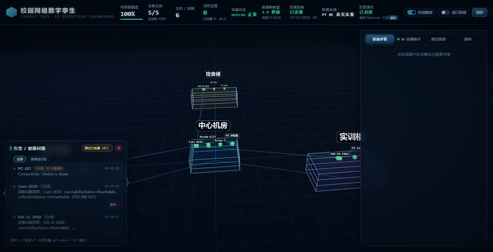
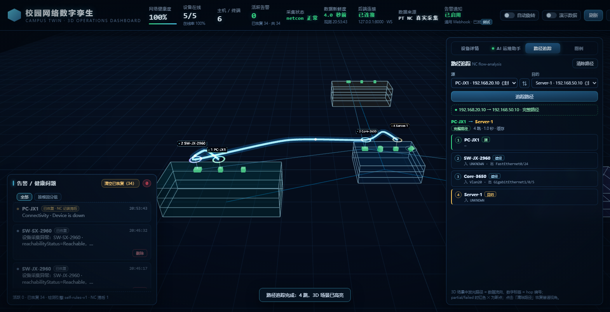
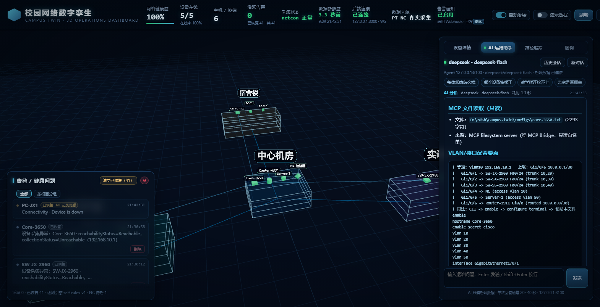
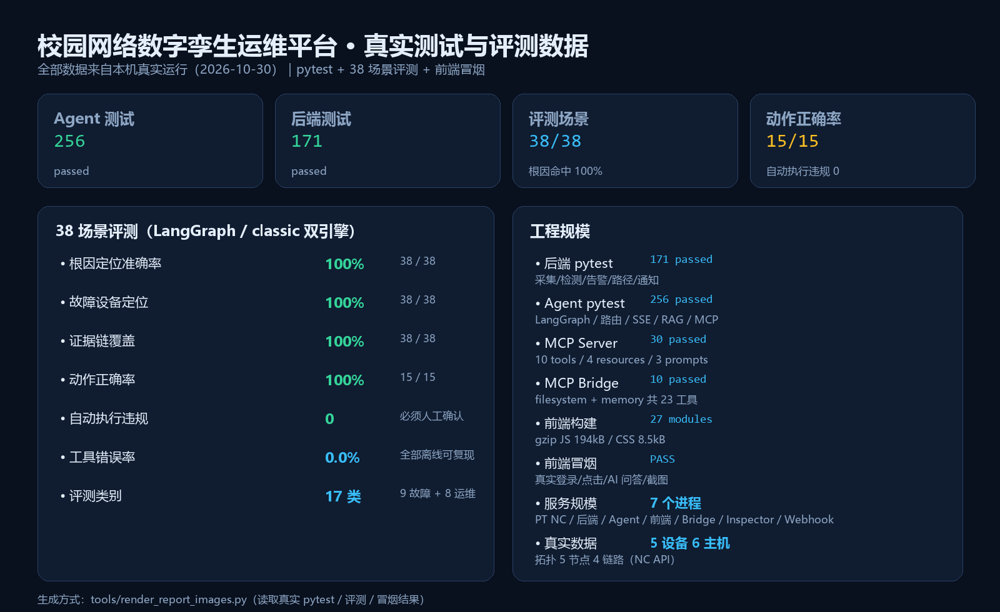

# 校园网络数字孪生运维平台 · 作品集

> 以 Cisco Packet Tracer 9 + Network Controller 真实 REST API 为数据源，构建「采集—检测—归因—建议—验证」运维闭环；
> AI 侧用 **LangGraph 多 Agent** 编排，支持流式对话、RAG 引用、人机确认写操作与 **MCP 双向集成**；前端为 Three.js 3D 数字孪生大屏。

| 资源 | 链接 |
|---|---|
| 💻 代码仓库 | [github.com/zz-147/campus-twin](https://github.com/zz-147/campus-twin) |
| 📄 作品集 PDF（20 页） | [作品集.pdf](./作品集.pdf) |
| 📊 作品集 PPTX 源文件 | [作品集.pptx](./作品集.pptx) |
| 🧠 面试问答手册 | [面试问答手册.md](./面试问答手册.md) |
| 🤖 飞书机器人 | [飞书机器人接入.md](./飞书机器人接入.md) · [实现说明](./飞书机器人.md) |

---

## 核心数据（全部真实运行）

| 维度 | 数据 |
|---|---|
| 真实网络纳管 | **5 台网络设备**（Core-3650 / 3×2960 / ISR4331）全部 Managed、**6 台终端**、拓扑 5 节点 4 链路，5 秒采集周期 |
| 故障检测 | 端口注入 → **5 秒内** critical 告警；NC 告警清除滞后 >3 分钟 → 自建恢复判定 + `stale_source` |
| AI Agent | **LangGraph** StateGraph 12 节点、8 role 并行、23 工具（17 原生 + 6 MCP）、SSE 流式（实测 2600+ token 事件）、RAG 107 chunks块 |
| MCP | 自建 **MCP Server**（10 tools / 4 resources / 3 prompts）+ **MCP Client 桥接**（filesystem 14 + memory 9 = 23 工具） |
| 测试 | 后端 **209** / Agent **291** / MCP Server **30** + Bridge **10** tests，全离线可跑 |
| 飞书通知 | 富卡片告警/恢复（红/绿）+ 运行时配置 API + 前端设置对话框 + 持久化 |
| 交互完善 | 场景设备命名规范/自动纠正、Agent 删除设备（记忆 + 确认卡片）、AI 对话框 1080px 放大 |
| 设备配置文档 | 加设备自动生成 Markdown 配置文档（完整 CLI/验证/撤销）+ 前端下载按钮 + CLI 一键复制 |
| 评测 | **38 场景**（LangGraph / 自研双引擎）：根因 100%、设备定位 100%、动作正确率 100%、**自动执行违规 0** |
| 飞书机器人 | 长连接双向接入（无需公网）：状态/告警/路径/读配置/任意问答，白名单+限流+去重，写操作只提示不执行 |
| RAG 评测（W15） | 107 chunk / 48 query / 4 配置：recall@5 1.0、MRR 0.877、引用准确率 0.333、faithfulness 0.660 |
| 可靠性/可观测性 | 277 tests；重试/熔断/幂等/脏数据；断点恢复（进程重启 4308ms）；trace_events + 4 API |
| 部署/CI | Docker 28.1.1 + Compose 校验 PASS、hello-world 运行；**GitHub Actions 6 job 全绿** |
| 安全 | 写操作必须人工确认（LangGraph `interrupt()`）、10 分钟 TTL、CAS 防重、软删除 + 审计 + 撤销；API Key 不入库 |

---

## 截图速览

### 平台总览（真实 NC 数据）

### 路径追踪 3D（真实 NC flow-analysis，4 跳）

### Agent 通过 MCP 读取真实配置文件

### 测试与评测数据

> 完整 18 张截图见 [作品集.md](./作品集.md)（含 PT 拓扑、系统架构、流式/RAG、危险操作确认、根因分组、MCP Inspector 等）。

---

## 文档索引

| 文档 | 内容 |
|---|---|
| [作品集.md](./作品集.md) | 18 张截图说明 + 使用建议 + 复现命令 |
| [项目总结.md](./项目总结.md) | 技术亮点、量化指标、面试问答速查 |
| [MCP接入说明.md](./MCP接入说明.md) | MCP Server / Bridge 架构、配置、安全、验证 |
| [飞书机器人接入.md](./飞书机器人接入.md) | 飞书机器人长连接配置、指令、安全设计、实测记录 |
| [部署与CI.md](./部署与CI.md) | 本地/Docker Compose/GitHub Actions 部署说明 |
| [故障注入实验记录.md](./故障注入实验记录.md) | 真实故障注入实验（5 秒告警、恢复判定） |
| [校园网络拓扑设计.md](./校园网络拓扑设计.md) | VLAN / Trunk / OSPF / 设备清单与配置思路 |
| [演示脚本.md](./演示脚本.md) · [录屏演示脚本.md](./录屏演示脚本.md) | 3 分钟 / 5 分钟演示流程与台词 |

## 说明

- 截图均为真实运行（3 张 Mock 状态图已在文档中标注）。
- 代码仓库：[campus-twin](https://github.com/zz-147/campus-twin)；不含任何 API Key（`.env` 已在 `.gitignore` 中排除）。
